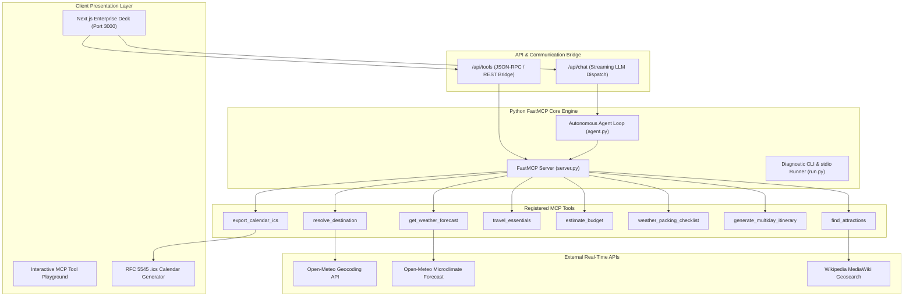

# WeekendWiz - Autonomous Enterprise Travel Concierge

[](https://github.com/PS-Dev-Dadhania/MCP-L2/actions/workflows/ci.yml)


An enterprise-grade, autonomous travel planning concierge built on Anthropic's **Model Context Protocol (MCP)** Level 2 specification. The system bridges large language model reasoning (Google Gemini and Groq) with eight deterministic backend tools, providing real-time meteorological forecasting, sanitized points of interest, regional transit logistics, localized budgeting in Indian Rupees (INR / Rs.), and RFC 5545 iCalendar schedule synchronization.

---

## 1. Executive Summary

Traditional generative travel assistants suffer from hallucinations, fabricated booking codes, outdated meteorological information, and unrealistic currency projections. 

WeekendWiz eliminates these failure modes by enforcing a strict protocol separation:
* **Generative Layer**: LLMs (Gemini / Groq) handle natural language comprehension, trip persona synthesis, and conversational interactions.
* **Deterministic MCP Layer**: The FastMCP server executes strictly typed, verified functions against live meteorological sources (Open-Meteo), geographic databases, and verified encyclopedic references (Wikipedia MediaWiki API).
* **Defensive Guardrails**: Content sanitization filters out tragic historical events and sensitive terms from tourist POI discovery, and budget models use localized Purchasing Power Parity (PPP) tiers.

---

## 2. End-to-End System Architecture



---

## 3. Autonomous Execution Flow

When a user requests an itinerary (e.g., "Plan a 3-day cultural tour of Ahmedabad"), the agent executes the following multi-step pipeline:

```
[User Request]
       |
       v
[Step 1: Geocoding Resolution] --------> Queries Open-Meteo for coordinates, timezone, elevation
       |
       v
[Step 2: Microclimate Analysis] -------> Fetches multi-day temperature, precipitation probability, WMO conditions
       |
       v
[Step 3: Landmark Extraction] ----------> Queries Wikipedia geosearch (10km radius) + keyword sanitization filter
       |
       v
[Step 4: City Logistics Lookup] --------> Resolves airport hubs, metro/bus transit, plugs (Type C/D/M), emergency numbers
       |
       v
[Step 5: Localized Cost Modeling] ------> Calculates lodging, food, transit, activities, and 10% contingency in INR (Rs.)
       |
       v
[Step 6: Weather-Adaptive Packing] -----> Generates packing checklist and indoor rain contingency plans
       |
       v
[Step 7: Schedule Slotting] ------------> Allocates Morning (09:00), Afternoon (13:30), and Evening (18:30) POI slots
       |
       v
[Step 8: RFC 5545 iCalendar Sync] -----> Formats VCALENDAR / VEVENT data for Google, Outlook, and Apple Calendar
```

---

## 4. MCP Tool Specification Matrix

All tools are registered via the `@mcp.tool()` decorator on the FastMCP instance:

| Tool Name | Scope / Responsibility | Primary Input | Output Payload | Upstream Provider |
| :--- | :--- | :--- | :--- | :--- |
| `resolve_destination` | Resolves city names to geographic coordinates | `city: str` | Lat, Lon, Country, Timezone, Elevation | Open-Meteo Geocoding |
| `get_weather_forecast` | Retrieves current metrics and multi-day forecast | `latitude: float`, `longitude: float`, `days: int` | Temp, Feels Like, WMO Condition, Rain % | Open-Meteo Weather |
| `find_attractions` | Discovers verified cultural landmarks | `city: str`, `category: str`, `limit: int` | POI names, distances, Wikipedia links | Wikipedia MediaWiki |
| `travel_essentials` | Supplies local transit, airports, plugs, etiquette | `city: str` | Airport codes, transit guide, plugs, emergency | Curated Knowledge Base |
| `estimate_budget` | Computes tiered budgets with PPP adjustments | `city: str`, `days: int`, `travel_style: str`, `currency: str` | Lodging, Dining, Transit, Activities, Contingency | Localized Cost Engine |
| `weather_packing_checklist` | Recommends attire and gear from weather data | `city: str` | Recommended gear, climate advisory, rain contingency | Dynamic Rule Engine |
| `generate_multiday_itinerary` | Assembles multi-day morning/afternoon/evening plan | `city: str`, `days: int`, `style: str` | Chronological schedule, maps URLs, rain backups | Composite Orchestrator |
| `export_calendar_ics` | Generates RFC 5545 compliant calendar export | `city: str`, `days: int` | Full `.ics` string, headers, VEVENT blocks | RFC 5545 Serializer |

---

## 5. Repository Structure

```
MCP-L2/
├── .github/
│   └── workflows/
│       └── ci.yml                    # Automated GitHub Actions CI (Tests + Build)
├── docs/                             # Engineering & Technical Specifications
│   ├── ARCHITECTURE.md               # System Topology, Flow Diagrams & Safety Controls
│   └── MCP_SPECIFICATION.md          # FastMCP Tool Signatures & Parameter Schemas
├── tests/                            # Automated Testing Suite
│   ├── __init__.py
│   └── test_mcp_suite.py             # 30-case QA verification suite (pytest compatible)
├── chatdeck/                         # Next.js Enterprise Web Deck & MCP Bridge
│   ├── app/                          # App Router (/ and API routes /api/chat, /api/tools)
│   ├── components/                   # React 19 / Tailwind CSS / Radix UI modules
│   │   └── Blocks/                   # Deck, Architecture, and Logs UI modules
│   ├── lib/                          # Utility functions
│   ├── package.json                  # Package configuration ("weekendwiz-chatdeck" v2.0.0)
│   ├── Dockerfile                    # Container definition for frontend
│   └── .env.example                  # Frontend environment template
├── weekendwiz/                       # Core Python FastMCP Server & AI Agent
│   ├── server.py                     # Canonical FastMCP server definition & 8 MCP Tools
│   ├── agent.py                      # Multi-step autonomous LLM tool calling engine
│   ├── run.py                        # Diagnostic CLI & stdio MCP transport runner
│   ├── s.py                          # Backward-compatibility import shim
│   ├── pyproject.toml                # Standard PEP 517/621 Python package configuration
│   ├── requirements.txt              # Production Python dependencies
│   ├── Dockerfile                    # Container definition for backend
│   └── .env.example                  # Backend environment template
├── docker-compose.yml                # Multi-container orchestration (Backend + Frontend)
├── qa_test_suite.py                  # Standalone QA test execution runner
├── .gitignore                        # Git exclusion rules (node_modules, .next, secrets)
└── README.md                         # Project documentation & setup instructions
```

---

## 6. Quick Start Guide

### Prerequisites
* Python 3.10 or 3.11
* Node.js 18.0 or higher
* npm or pnpm

### Option 1: Native Local Installation

#### Backend (Python FastMCP Server)
```bash
cd weekendwiz

# Set up virtual environment
python -m venv .venv
source .venv/bin/activate       # On Windows: .venv\Scripts\activate

# Install dependencies
pip install -r requirements.txt

# Configure environment
cp .env.example .env
# Set GROQ_API_KEY and GEMINI_API_KEY in .env

# Run diagnostic test suite
python run.py --test

# Start stdio FastMCP server
python server.py
```

#### Frontend (Next.js Web Deck)
```bash
cd ../chatdeck

# Install dependencies
npm ci

# Configure environment
cp .env.example .env.local
# Set GROQ_API_KEY and GEMINI_API_KEY in .env.local

# Build and start production server
npm run build
npm start

# Access the interface at http://localhost:3000
```

### Option 2: Docker Compose Deployment
```bash
# Set environment variables
export GROQ_API_KEY="your_groq_api_key"
export GEMINI_API_KEY="your_gemini_api_key"

# Build and start all services
docker compose up --build
```
Both services will initialize:
* Web Interface: `http://localhost:3000`
* FastMCP Server: `localhost:8000`

---

## 7. Quality Assurance & Automated Testing

The project includes an automated test suite verifying edge cases, network boundaries, input sanitization, and output validity:

```bash
# Run via root QA runner
python qa_test_suite.py

# Or run via pytest
pytest tests/ -v
```

### Test Coverage Highlights
* **Geocoding & Diacritics**: Verifies non-ASCII city resolution (e.g., Zurich with umlauts, Sao Paulo with tildes).
* **Boundary Value Analysis (BVA)**: Clamps day limits to valid trip ranges (1 to 14 days), handling negative or zero day inputs safely.
* **Content Sanitization**: Validates that Wikipedia geosearch queries filter out sensitive, tragic, or school articles from tourist attraction pools.
* **Currency & PPP Accuracy**: Confirms that Ahmedabad daily costs are computed in Indian Rupees (`INR` / `Rs.`) within realistic domestic ranges.
* **RFC 5545 Syntax Integrity**: Ensures that generated calendar files include valid `BEGIN:VCALENDAR`, `VERSION:2.0`, `PRODID`, `VEVENT`, and UTC timestamps.

---

## 8. Continuous Integration

Every push and pull request to `main` is validated by a GitHub Actions workflow (`.github/workflows/ci.yml`):
1. **Python Backend**: Compiles Python source files (`py_compile`), verifies dependencies, and tests package import integrity.
2. **Next.js Frontend**: Executes `npm ci` and runs `npm run build` to catch TypeScript, layout, or bundling issues.

---

## 9. Security & Responsible Disclosure

* No production credentials or API keys are stored in source control.
* All configuration is injected via environment variables (`.env`, `.env.local`).
* External requests to Wikipedia enforce standard `User-Agent` identification headers to adhere to Wikimedia Foundation API guidelines.

---

## 10. License

This project is licensed under the MIT License.
